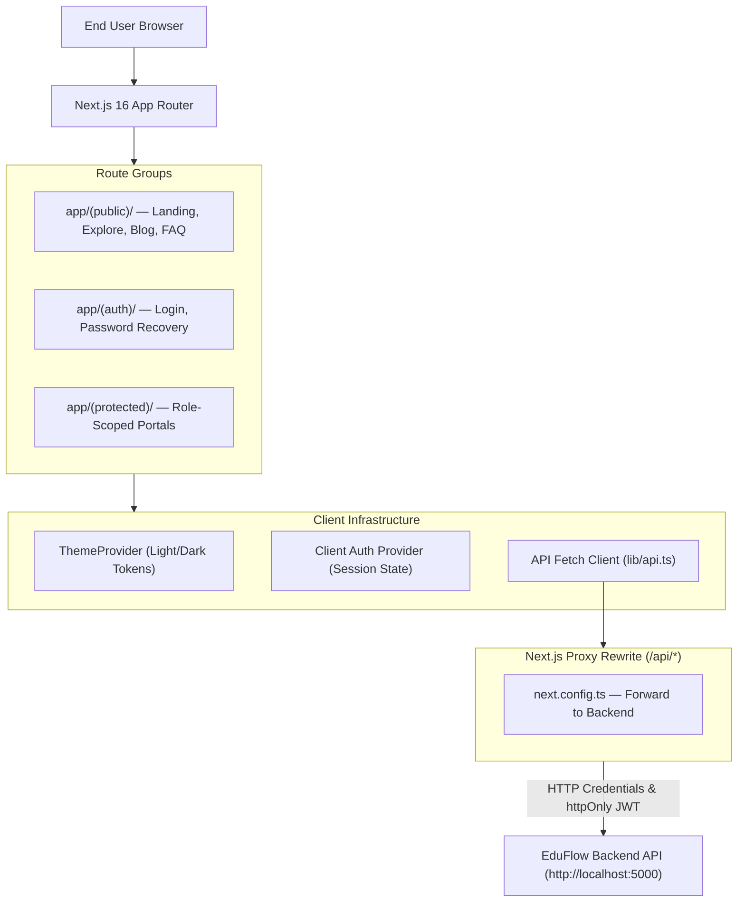

# 🎨 EduFlow Frontend — Next.js 16 Client & Portal Interface

> Modern, accessible multi-role coaching center web application and digital assessment portal built with Next.js 16 (App Router), React 19, TypeScript, and Tailwind CSS v4.

[](https://nextjs.org/)
[](https://react.dev/)
[](https://www.typescriptlang.org/)
[](https://tailwindcss.com/)
[](https://lucide.dev/)
[](https://github.com/pacocoursey/next-themes)

---

## 📌 Table of Contents

- [About the Project](#-about-the-project)
- [Project Overview](#-project-overview)
- [Key Features](#-key-features)
- [Tech Stack](#-tech-stack)
- [Application Architecture](#-application-architecture)
- [Routing & Page Structure](#-routing--page-structure)
- [Design System & UI Components](#-design-system--ui-components)
- [Folder Structure](#-folder-structure)
- [Prerequisites](#-prerequisites)
- [Installation & Setup](#-installation--setup)
- [Environment Variables](#-environment-variables)
- [Connecting to the Backend](#-connecting-to-the-backend)
- [Running the Frontend](#-running-the-frontend)
- [Quality Assurance & Verification](#-quality-assurance--verification)
- [How to Contribute](#-how-to-contribute)
- [License](#-license)
- [Contact](#-contact)

---

## 💡 About the Project

The **EduFlow Frontend Web Application** is the client interface for the EduFlow coaching center management platform. It delivers role-tailored dashboards and operational tools for coaching center administrators, teachers, students, and guardians.

Designed as an independent single-page and server-rendered web application, it communicates with the separately maintained [EduFlow Backend API](https://github.com/tasifhossan/eduflow-backend) via credentialed HTTP requests and server-side proxy rewrites.

---

## 🧭 Project Overview

- **Role-Aware Portal Experiences**: Adapts navigation and permissions dynamically across 5 user perspectives (`SUPER_ADMIN`, `ADMIN`, `TEACHER`, `STUDENT`, `GUARDIAN`).
- **Interactive Assessment Suite**: Provides a distraction-free exam room with real-time countdown timers, question palettes, autosave status indicators, and immediate score breakdowns.
- **Unified Design Tokens**: Built upon Tailwind CSS v4 and a tokenized design system (`lib/theme.ts`) that guarantees WCAG AA contrast compliance (4.5:1 text, 3:1 graphical elements) across light and dark modes.
- **Zero-Friction Authentication**: Interacts with the backend via secure, HTTP-only JWT cookies forwarded through Next.js proxy rewrites to maintain first-party cookie privacy.

---

## ✨ Key Features

### 🏛️ 1. Role-Tailored Portals & Layouts
- **Super Admin & Admin**: Centralized dashboards featuring cohort health statistics, admissions lead tracking, batch configurations, fee collection tables, and audit logs.
- **Teacher Workspace**: Assigned batch routines, lecture management with join window indicators, attendance grids, and subjective exam grading interfaces.
- **Student Dashboard**: Enrolled batch cards, upcoming class routines, syllabus progress, printable fee receipts, and the online exam runner.
- **Guardian Portal**: Multi-child view allowing guardians to track attendance history, academic report cards, and fee dues across linked students.

### 📝 2. Timed Assessment Runner
- **Active Exam Interface**: Features an intuitive question palette, answered/unanswered progress counters, and countdown timers with warning thresholds.
- **Autosave Reliability**: Transmits periodic answer heartbeats in the background, updating status indicators in real time.
- **Post-Exam Leaderboards**: Visualizes batch score distributions, rank ties, and chapter-by-chapter weak-spot analytics.

### 💰 3. Financial Management & Receipting
- **Fee Collection & Receipts**: Printable, gap-free payment receipts with standardized layout templates (`/fees/receipts/[paymentId]`).
- **Student Dues & History**: Transparent ledger breakdown displaying total due, paid amount, and payment history per student.

### 🌐 4. Public Catalog & Content Pages
- **Public Course Catalog**: Searchable and filterable batch explore directory (`/explore`) with admission/academic category tags.
- **Public Batch Landing Pages**: Detailed course syllabi, instructor highlights, and admissions CTA (`/explore/[slug]`).
- **Institutional Content**: Complete auxiliary public pages including About, Contact, Blog, FAQ, Privacy Policy, and Terms of Service.

### 🌓 5. Design System & Theme Engine
- **Accessible Palette**: Built on theme variables (`--background`, `--foreground`, `--card`, `--primary`, `--status-*`) verified against AA contrast guidelines.
- **Theme Switcher**: Instant switching between light and dark themes via `next-themes`.
- **Interactive Showcase**: Live design system gallery at `/design-system` displaying all shared UI components, buttons, badges, and empty/error states.

---

## 🛠️ Tech Stack

<p align="center">
  <a href="https://skillicons.dev">
    
  </a>
</p>

- **Framework:** Next.js 16 (App Router, Turbopack)
- **Library:** React 19
- **Language:** TypeScript 5
- **Styling:** Tailwind CSS v4 with custom design tokens (`app/globals.css`, `lib/theme.ts`)
- **Iconography:** Lucide React (`lucide-react`)
- **State & Theming:** `next-themes` (Dark/Light themes), native React hooks
- **Form Handling:** React Hook Form + Zod (`@hookform/resolvers`)
- **Notifications:** Sonner toast manager (`sonner`)
- **Utilities:** `clsx`, `tailwind-merge`

---

## 🏗️ Application Architecture

The frontend uses Next.js 16 App Router route groups to isolate public marketing pages, authentication flows, and protected operational dashboards:



---

## 🗺️ Routing & Page Structure

```plaintext
app/
├── (public)/                       # Publicly accessible routes
│   ├── page.tsx                    # Landing page (Hero, Stats, Features, Testimonials)
│   ├── explore/                    # Course/Batch explore directory
│   │   ├── page.tsx                # Filterable batch catalog
│   │   └── [slug]/page.tsx         # Public batch details & syllabus outline
│   ├── about/page.tsx              # Institutional about page
│   ├── contact/page.tsx            # Contact form with validation
│   ├── blog/                       # Published educational articles
│   │   ├── page.tsx                # Blog directory
│   │   └── [slug]/page.tsx         # Blog article reader
│   ├── faq/page.tsx                # Frequently asked questions
│   ├── privacy/page.tsx            # Privacy policy
│   └── terms/page.tsx              # Terms of service
│
├── (auth)/                         # Authentication flows
│   ├── login/page.tsx              # User login with demo shortcuts
│   ├── forgot-password/page.tsx    # Password reset request
│   ├── reset-password/page.tsx     # Password reset token entry
│   └── change-password/page.tsx    # Mandatory password change gate
│
├── (protected)/                    # Authenticated dashboard views
│   ├── dashboard/page.tsx          # Dynamic role-tailored home dashboard
│   ├── admissions/page.tsx         # Lead management & student conversion
│   ├── batches/                    # Batch administration
│   │   ├── [id]/page.tsx           # Batch details & routine
│   │   ├── [id]/analytics/page.tsx # Performance weak-spot analysis
│   │   └── [id]/tests/             # Batch test management
│   ├── tests/                      # Exam hub
│   │   └── [testId]/take/page.tsx  # Timed online exam interface
│   ├── attendance/                 # Attendance recording & monthly matrix
│   ├── fees/                       # Fee collections, dues, and receipts
│   ├── students/                   # Student directory & profiles
│   ├── guardians/                  # Guardian linkage & contact sync
│   ├── lectures/                   # Scheduled lectures & join windows
│   ├── assignments/                # Homework submissions & grading
│   ├── my-fees/page.tsx            # Student personal fee dues & receipt view
│   ├── my-children/page.tsx        # Guardian child overview
│   ├── my-report-cards/page.tsx    # Academic progress cards
│   ├── notices/page.tsx            # Notice board
│   └── settings/page.tsx           # Center settings & feature flags
│
└── design-system/page.tsx          # Live UI component token gallery
```

---

## 🎨 Design System & UI Components

EduFlow implements a structured UI component architecture adhering to WCAG AA guidelines:

| Component | Path | Description |
| :--- | :--- | :--- |
| **`PageHeader`** | `components/dashboard/page-header.tsx` | Standardized page title, breadcrumbs, and primary CTA actions |
| **`DataTable`** | `components/ui/data-table.tsx` | Accessible table shell with sorting, pagination, and empty states |
| **`StatusBadge`** | `components/ui/status-badge.tsx` | Standardized status chips (`SUCCESS`, `WARNING`, `DANGER`, `INFO`) |
| **`EmptyState`** | `components/ui/empty-state.tsx` | Consistent illustration, message, and action CTA for empty data |
| **`ErrorState`** | `components/ui/error-state.tsx` | User-friendly error recovery card with retry trigger |
| **`ThemeToggle`** | `components/ui/theme-toggle.tsx` | Accessible light/dark theme switcher |

> **Design System Showcase:** When running in development, visit [http://localhost:3000/design-system](http://localhost:3000/design-system) to inspect all components and tokens live.

---

## 📁 Folder Structure

```plaintext
frontend/
├── app/                            # Next.js 16 App Router hierarchy
│   ├── (auth)/                     # Auth routes (login, password reset)
│   ├── (protected)/                # Role-gated dashboard routes
│   ├── (public)/                   # Marketing and public catalog routes
│   ├── design-system/              # Design system showcase
│   ├── globals.css                 # Tailwind CSS v4 theme variables
│   └── layout.tsx                  # Root layout with theme provider
├── components/
│   ├── dashboard/                  # Dashboard widgets, stats cards, headers
│   ├── layout/                     # Navbar, Footer, Mobile menu drawer
│   ├── providers/                  # Theme & client session providers
│   └── ui/                         # Atomic design token components
├── docs/
│   └── DESIGN_SYSTEM.md            # Color tokens & accessibility specifications
├── lib/
│   ├── api.ts                      # Client-side API fetch wrapper
│   ├── client-auth.ts              # Client authentication state utilities
│   ├── format.ts                   # Date, time, and currency formatters
│   ├── site-config.ts              # Institutional metadata and navigation links
│   └── theme.ts                    # Semantic color tokens and status utilities
├── public/                         # Static image assets and icons
├── tsconfig.json                   # TypeScript configuration
└── package.json                    # Dependencies and script definitions
```

---

## 📋 Prerequisites

- **Node.js**: `v20.18.0` or higher (verified on `v24.15.0 LTS`)
- **npm**: `v10.x` or higher
- **EduFlow Backend**: The backend API service running locally or accessible remotely

---

## 🚀 Installation & Setup

1. **Navigate to the frontend directory:**
   ```bash
   cd frontend
   ```

2. **Install project dependencies:**
   ```bash
   npm install
   ```

3. **Configure local environment variables:**
   ```bash
   cp .env.example .env.local
   ```
   *Edit `.env.local` to point to your local backend (see details below).*

---

## 🔐 Environment Variables

Configure the following variables in `frontend/.env.local`:

| Variable | Description | Required | Example / Default |
| :--- | :--- | :---: | :--- |
| `NEXT_PUBLIC_API_URL` | Base backend server URL (**without** `/api` suffix) | **Yes** | `http://localhost:5000` |
| `NEXT_PUBLIC_SITE_URL`| Canonical site URL for metadata, sitemaps, and robots.txt | No | `http://localhost:3000` |
| `NEXT_PUBLIC_APP_NAME`| Platform brand display name | No | `EduFlow` |
| `NEXT_PUBLIC_DEV_SHORTCUTS` | Shows quick demo role login buttons on `/login` (dev only) | No | `true` |

> ⚠️ **Important:** Do **not** append `/api` to `NEXT_PUBLIC_API_URL`. Next.js rewrites in `next.config.ts` automatically forward `/api/:path*` to `${NEXT_PUBLIC_API_URL}/api/:path*`.

---

## 🔗 Connecting to the Backend

The frontend requires the separate [EduFlow Backend Service](https://github.com/tasifhossan/eduflow-backend) to be running.

### 1. Local Development Flow
1. Start the backend service in its own terminal on port `5000`:
   ```bash
   cd ../backend
   npm run dev
   ```
2. Verify the backend is listening: [http://localhost:5000](http://localhost:5000)
3. Ensure `frontend/.env.local` has:
   ```env
   NEXT_PUBLIC_API_URL="http://localhost:5000"
   ```
4. Start the frontend development server on port `3000`:
   ```bash
   cd ../frontend
   npm run dev
   ```

### 2. Cookie Proxy Architecture
When client components make requests via `lib/api.ts`, they call relative paths like `/api/auth/me`. Next.js proxy rewrites intercept these requests and forward them to `http://localhost:5000/api/auth/me`. This guarantees:
- **First-Party Cookies**: Authentication cookies are treated as first-party by the browser.
- **Zero CORS Hassle**: Eliminates cross-origin cookie blocking in strict modern browsers.

---

## 🏃 Running the Frontend

### Development Mode (with Turbopack hot-reload):
```bash
npm run dev
# Application available at http://localhost:3000
```

### Production Build & Execution:
```bash
npm run build
npm run start
```

---

## 🧪 Quality Assurance & Verification

Run these automated checks to verify code formatting, type integrity, and design tokens:

```bash
# 1. TypeScript Static Typecheck
npx tsc --noEmit

# 2. Next.js ESLint Check
npm run lint

# 3. Verify Design Token Usage & Prevent Raw Palette Classes
npm run check:colors

# 4. Verify Theme Variables & Contrast
npm run check:theme

# 5. Production Build Verification
npm run build
```

---

## 🤝 How to Contribute

1. Fork the repository (`https://github.com/tasifhossan/eduflow-frontend/fork`).
2. Create your feature branch (`git checkout -b feature/AmazingUIFeature`).
3. Commit your changes (`git commit -m 'feat: Add AmazingUIFeature'`).
4. Ensure the typecheck and linter pass:
   ```bash
   npx tsc --noEmit
   npm run lint
   ```
5. Push to the branch (`git push origin feature/AmazingUIFeature`).
6. Open a Pull Request detailing your UI changes and responsive behavior.

---

## 📄 License

Distributed under the **MIT License**. See `LICENSE` for more information.

---

## 📬 Contact

**Lead Developer:** [Tasif Hossan](https://github.com/tasifhossan)  
**Frontend Repository:** [https://github.com/tasifhossan/eduflow-frontend](https://github.com/tasifhossan/eduflow-frontend)  
**Backend Repository:** [https://github.com/tasifhossan/eduflow-backend](https://github.com/tasifhossan/eduflow-backend)
